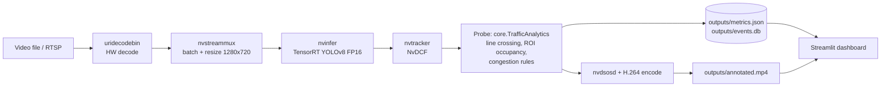

# Architecture

**One analytics code path.** `core/` (pure Python, no GPU needed) is used by the Windows prototype, the simulator and the DeepStream probe, so the logic tested on a laptop is the logic that runs on the edge device.

| Module | Role |
|---|---|
| `core/types.py` | `Track`, vehicle-class filter, untracked-ID handling |
| `core/counting.py` | once-per-track-per-line crossing counter |
| `core/congestion.py` | ROI occupancy + Normal/Warning/Critical state machine with persistence/recovery |
| `core/pipeline.py` | per-frame orchestration, FPS, metrics dict |
| `core/store.py` | atomic `metrics.json` + SQLite alert history |
| `core/config.py` | validation of config and video sources |

Geometry in `config/analytics_config.json` is **normalised (0–1)**, so it works at any resolution.
Congestion = estimated indicator from vehicle count in a region held for N seconds. It is not measured speed and not a forecast.
